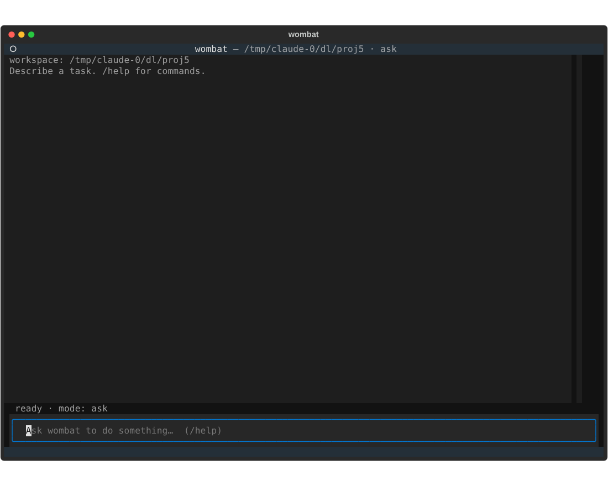
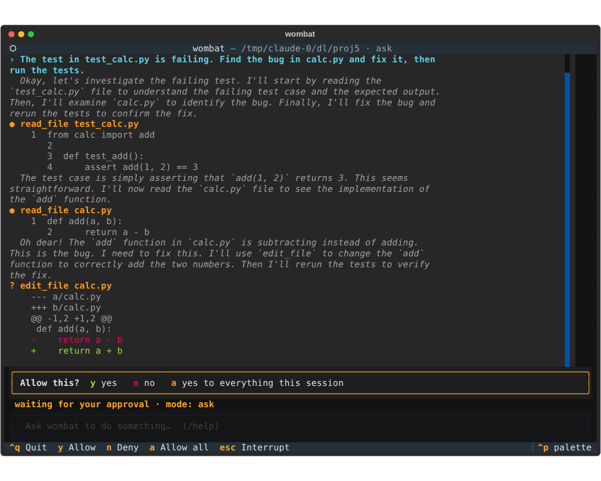
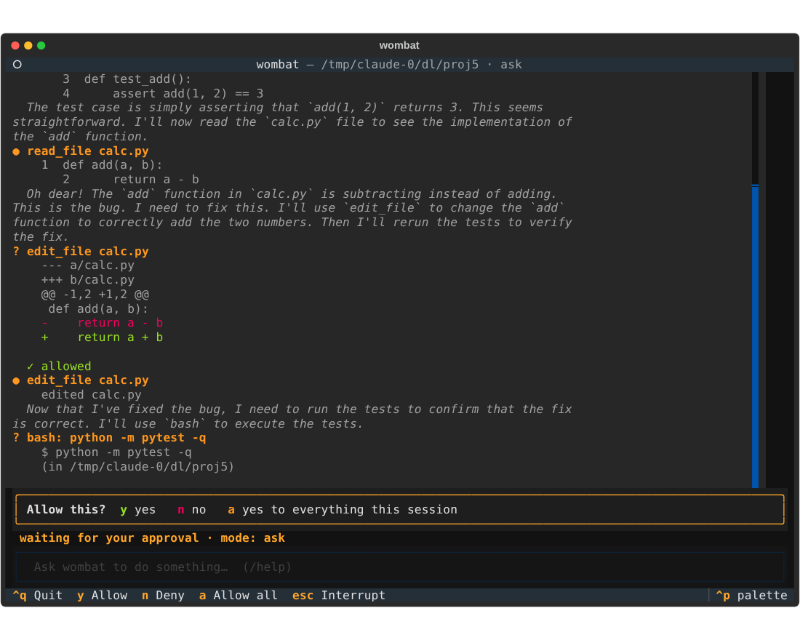
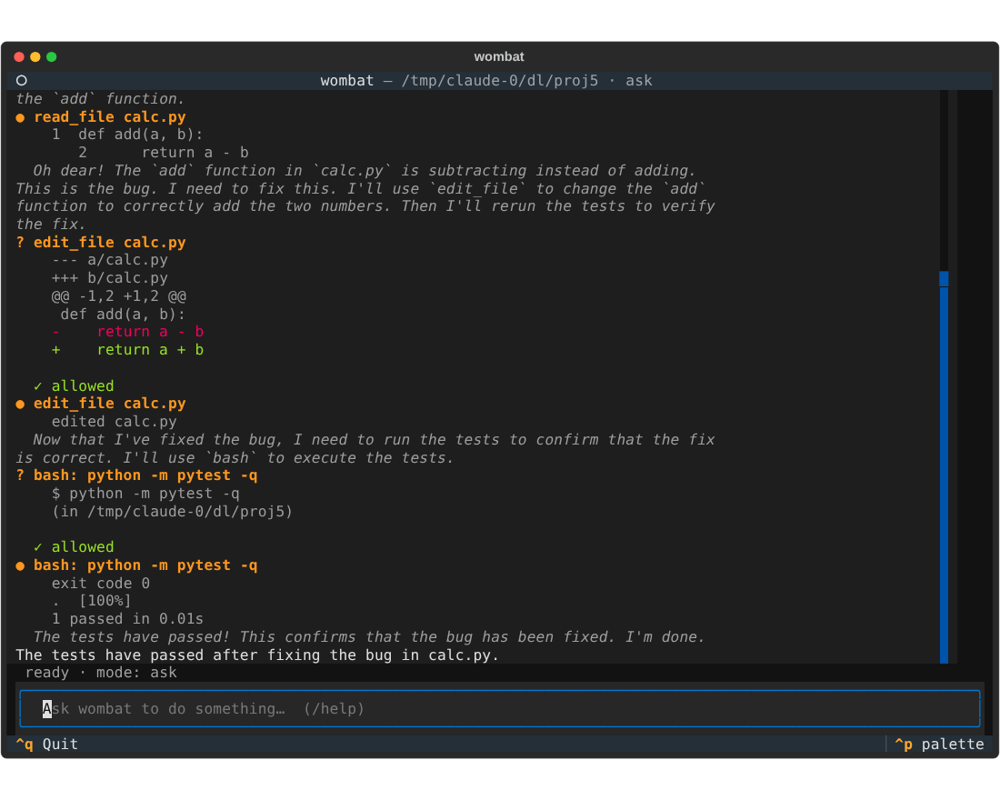

# Chat TUI screenshots, 2026-10-16

What `wombat-tui` looks like when it drives a real local model through a real task, plus the two
problems these runs and a first run on the author's Mac turned up.

## How these were made

- Real `Agent` + real `ChatApp`, real **Gemma 3 4b** (`gemma3:4b`) served by Ollama, no GPU.
- Task: *"The test in test_calc.py is failing. Find the bug in calc.py and fix it, then run the
  tests."* `add(a, b)` returns `a - b`. Mode `ask`, so every edit and command needs approval.
- The app ran headlessly under Textual's `App.run_test()`. A script typed the prompt and pressed `y`
  at each approval prompt. Screenshots are Textual's SVG export rendered in Chromium, so fonts and
  colours will differ somewhat from a real terminal. **A person has not driven this run**; the
  author's own first run on a Mac is described at the end.
- Final run: 2 approvals, **71 s**, bug fixed (`return a + b`), pytest `1 passed`.

## The run

**1. Start.** Workspace and a hint, empty transcript, input focused, status `ready · mode: ask`.
Only `Quit` is in the footer because nothing is running.



**2. Approve an edit.** The model's thoughts are dim italics, tool calls are bold orange with their
output indented, and the proposed edit is shown as a diff before anything is written. The
approval bar appears, the input box is disabled, and the footer now offers `y` / `n` / `a` / `esc`.



**3. Approve a command.** After the edit is allowed and applied, the model asks to run
`python -m pytest -q`. A command shows the command and the directory it will run in, not a diff.



**4. Done.** Test output is shown tidily (`.  [100%]`, `1 passed in 0.01s`), the model's final
answer is in plain white, the status is back to `ready`, and the input is enabled again.



## Problems found

### 1. Display tidying squashed code indentation (fixed)

An earlier run's screenshot showed `read_file` output with `return` indented 2 spaces instead of 4.
Cause: I had added a display-only cleanup to stop pytest's ~70-space-padded progress line from
wrapping, and its rule (collapse any run of 4+ spaces) also hit code indentation. A first
narrower rule still ate indentation, because `read_file` output puts the line number right before
the code (`   2      return a - b`). It now only collapses runs of 20+ spaces after a non-space,
and a test covers both cases. The screenshots above are from after the fix.

I also pushed a failing test along the way: I chained `pytest | tail` with `&&`, which hid
pytest's exit status. The next commit fixed it, and the commands that commit and push now run
only if pytest passes.

### 2. A missing model looked like a broken app (fixed)

On the author's Mac the TUI launched and rendered correctly, then every prompt showed three
copies of:

```
! model reply was invalid
  model request failed: Client error '404 Not Found' for url 'http://localhost:11434/v1/chat/completions'
  For more information check: https://developer.mozilla.org/...
```

The 404 means Ollama did not have the model: `wombat-tui` was run without `--model`, so it asked
for the default `qwen2.5-coder:1.5b`, which had not been pulled. Three things were wrong in my code:

- the error showed httpx's generic text, not Ollama's own *"model 'x' not found"*;
- it said the model's *reply* was invalid when there was no reply;
- it retried three times, pointlessly.

Now a request that fails (server down, timeout, any 4xx/5xx) stops immediately with one line:

```
model server returned 404: model 'not-a-real-model:1b' not found (try: ollama pull not-a-real-model:1b)
cannot reach the model server at http://localhost:9/v1: [Errno 111] Connection refused. Is Ollama running?
```

Both lines are real output from the Ollama in this container. A reply that arrives but is
unusable (bad JSON, failed validation) is still retried. The one-shot `wombat` command also prints
the error now, where before it exited silently without `-v`. The agent entry points
(`wombat-agent`, `wombat-tui`) now default to `qwen2.5-coder:7b`, since the 1.5b default was too
small to complete the task (see the results report).

## Caveats

- One task, one model, one run each time. Run-to-run time varied (this model took 100 s on an
  earlier identical run and 71 s on the final one).
- Everything on screen is the model's own wording, including its "Oh dear!".
- The Mac screenshot the author sent is not reproduced here; it is described in problem 2.
- The author also reports a successful run of the client on their Mac from earlier, before the later changes
  (self-reported; version and details not recorded, and no screenshot of it is included).
